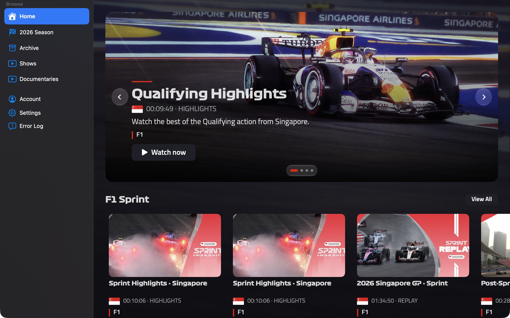
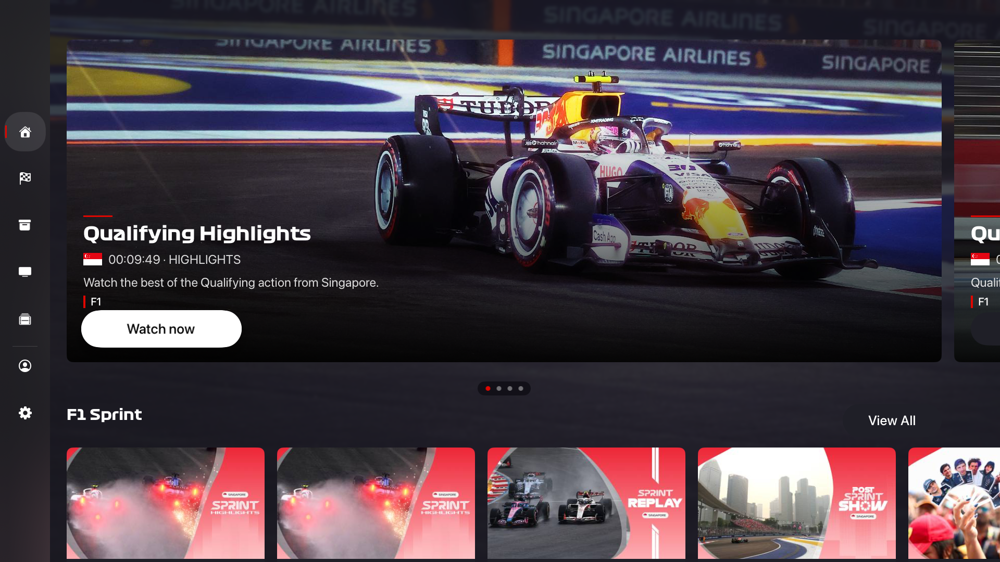
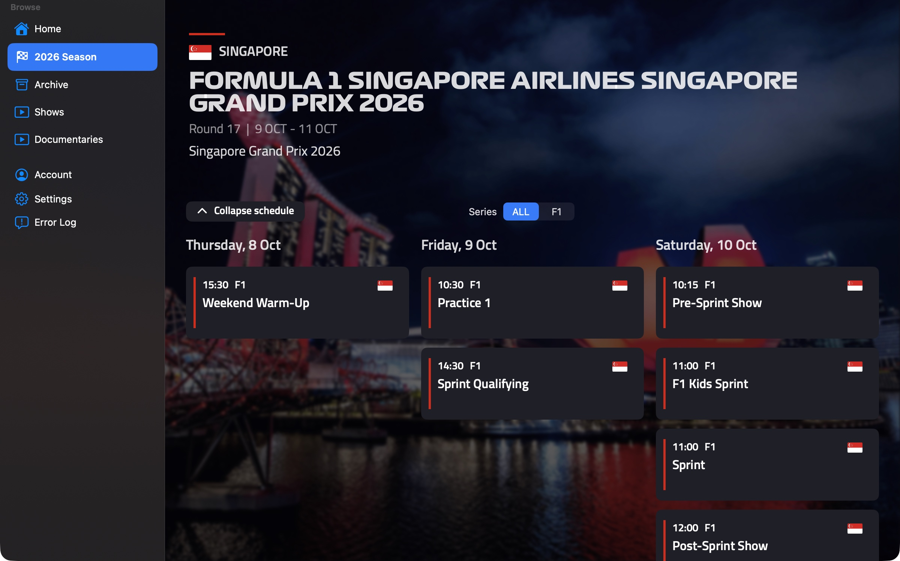
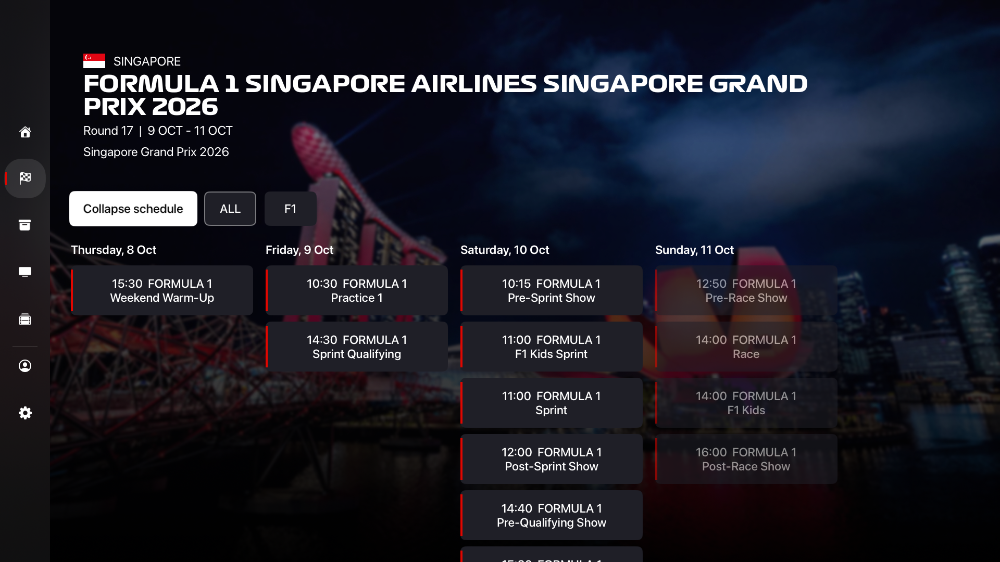

# Vroom TV

An unofficial F1 TV app for **Apple TV and Mac**. Watch races in up to **4K HDR**,
follow multiple feeds at once, and explore race weekends, replays, shows and
documentaries.

Watch on the big screen with Apple TV, or arrange individual feed windows across
your Mac's desktop and displays.

## Screenshots

Home and race-weekend schedules on both platforms. Select an image to view it
at full size.

| Mac | Apple TV |
| --- | --- |
|  |  |
|  |  |

## Features

- **Native 4K HDR playback** on Apple TV and Mac, when available for your content,
  subscription and hardware.
- **Multiview:** watch the main broadcast alongside available driver cameras and
  additional feeds.
- **Linked playback controls:** play, pause, seek and return to live across your
  open feeds, with separate volume, audio language and quality controls.
- **Live and replay viewing:** choose an available International or F1 Live feed
  and start a live session from the beginning or the live edge.
- **Race-weekend schedules** in your local timezone, with session details,
  country flags and series information.
- **Browse the F1 TV catalog:** the current season, archive, highlights, shows,
  documentaries and other available series.
- **Feed previews** to help choose what to watch, plus optional frame previews
  while scrubbing.
- **Saved setups:** restore your preferred feeds and audio settings.
- **Playback preferences:** choose your default feed, startup quality, audio
  language, captions and live-start behavior.

You need an F1 TV account with access to the content you want to watch. Vroom TV
does not include a subscription. Available feeds, resolution and HDR depend on
F1 TV, your subscription, connection, device and display.

## Apple TV

Vroom TV requires **tvOS 26 or later**. For 4K HDR viewing, use a compatible
**Apple TV 4K** connected to an HDR-capable display.

Watch a single feed with familiar Apple TV controls, or choose a multiview layout:
Single, Inset, Main + 1/2/3, or a Grid with arrangements including 2×2 and 4×4.
Auto adapts the layout as you add feeds. Save a setup to quickly restore your
preferred arrangement for another session.

### Install on Apple TV

1. Open the [TestFlight invitation](https://testflight.apple.com/join/NRswe1IZ)
   on your iPhone or iPad.
2. Install TestFlight on that device and your Apple TV using the same App Store
   account, then accept the invitation.
3. Open TestFlight on Apple TV and install Vroom TV.
4. Open Account in Vroom TV and sign in to F1 TV.

TestFlight availability depends on available tester places and published builds.
Check the invitation for the current requirements.

## Mac

Vroom TV requires **macOS 26 or later**. For HDR output, use a compatible Mac and
HDR-capable display.

Each feed opens in its own resizable window. Arrange them across your displays,
make a feed fullscreen, or keep one visible with **Always on Top**. Saved desktop
setups remember your feeds, audio settings and window positions.

Choose Automatic, SDR or HDR for each feed, and adjust quality to suit your
connection. Player controls and the mouse pointer hide while you're watching and
return when you interact.

### Install on Mac

1. Check [GitHub Releases](https://github.com/NoahFetz/F1AppleTV/releases) for a
   finished Mac build and download the macOS file under **Assets**.
2. Extract the download and move **F1A-Mac.app** to **Applications**.
3. Open the app, go to Account and sign in to F1 TV.
4. Choose something to watch and use **Add Feed** to open additional feeds.

Finished Mac downloads will appear on the Releases page as releases are published.
To update, download a newer release and replace the app in Applications.

### Watching on Mac

Browse Home, the current season, Archive, Shows or Documentaries. Open a race
weekend to see its schedule in your local timezone, then choose a session.

Use **Add Feed** to choose additional broadcasts or driver cameras. Additional
feeds open muted. Volume, quality, audio language and captions can be adjusted
separately for each feed. Opening an existing feed brings its window forward.

Drag over the video to move its window. **Save Setup / Load Setup** remembers
and restores your feeds, audio settings and window positions. Mac setups and
preferences are independent of your Apple TV setups.

### Mac controls

- **Space:** play or pause your linked feeds.
- **Left / Right:** skip back or forward ten seconds.
- **M:** mute or unmute the focused feed.
- **Go Live:** return your linked feeds to the live edge.
- **Sync All:** bring feeds back together if they drift apart.
- **Command-W:** close the focused feed window.
- **Timeline:** hover or drag to see a timecode. Enable **Settings → Playback →
  Scrubbing frame previews** for picture previews when available.

Closing the browsing window leaves playback running. Use **Show Catalog** to
return to browsing.

## Help and feedback

Report problems through [GitHub Issues](https://github.com/NoahFetz/F1AppleTV/issues).
Include your app version, macOS or tvOS version, device, affected content and the
steps to reproduce. For picture-quality issues, include your selected quality
and display model. You can find recent errors in the app's Error Log.

Please keep passwords and private account information out of public reports.

## About

Vroom TV is unofficial and is not associated in any way with the Formula 1
companies. F1, FORMULA ONE, FORMULA 1, FIA FORMULA ONE WORLD CHAMPIONSHIP, GRAND
PRIX and related marks are trade marks of Formula One Licensing B.V.

Thanks to [RaceControl](https://github.com/robvdpol/RaceControl) and the open-source
projects used by the apps:
[Alamofire](https://github.com/Alamofire/Alamofire),
[SkeletonView](https://github.com/Juanpe/SkeletonView),
[Kingfisher](https://github.com/onevcat/Kingfisher),
[SPAlert](https://github.com/ivanvorobei/SPAlert) and
[TvOSSlider](https://github.com/zattoo/TvOSSlider).

If you'd like to support development, you can
[buy me a coffee](https://www.buymeacoffee.com/NoahFetz).
